<div align="center">

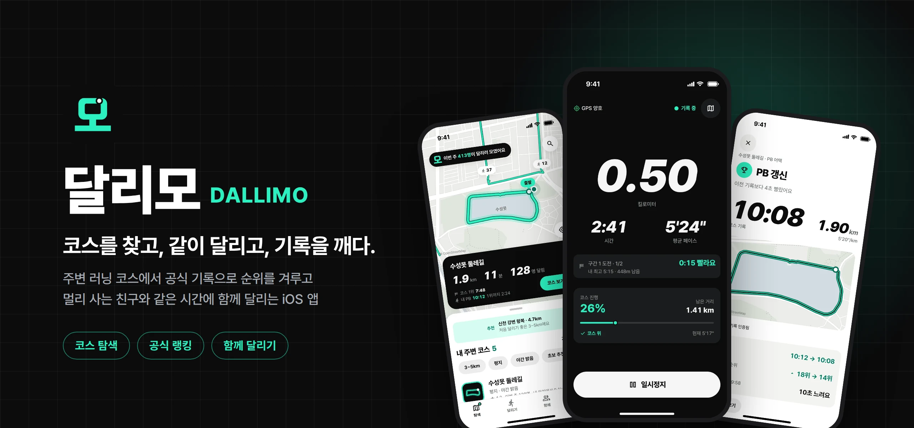

<br />
<br />

<a href="https://apps.apple.com/kr/app/%EB%8B%AC%EB%A6%AC%EB%AA%A8/id6818753247"></a>

<br />
<br />

<a href="https://dallimo-landing.kro.kr/"></a>
<a href="https://dallimo.gamjabox.cloud/swagger-ui.html"></a>
<a href="docs/spec/dallimo_master_spec_v1.8.md"></a>

</div>

<br />

## 📌 목차

[프로젝트 소개](#-프로젝트-소개) · [서비스 기획](#-서비스-기획) · [화면 구성](#-화면-구성) · [유저 플로우](#-유저-플로우) · [주요 기능](#-주요-기능) · [기술 스택](#-기술-스택) · [시스템 아키텍처](#-시스템-아키텍처) · [성능 개선](#-성능-개선) · [시작하기](#-시작하기)

<br />

## 🏃 프로젝트 소개

**달리모**는 코스가 중심인 iOS 러닝 앱입니다. 주변 러너가 공유한 코스를 찾고, 같은 코스에서 내 기록 · 친구 · 다른 러너와 순위를 겨룹니다. 사는 곳이 달라도 친구와 같은 시간에 출발해 실시간으로 함께 달릴 수 있습니다.

| 항목 | 내용 |
| --- | --- |
| 개발 기간 | 2026.09.27 ~ 운영 중 |
| 개발 인원 | 1인 (기획 · 디자인 · iOS · watchOS · 서버 · 인프라) |
| 플랫폼 | iOS · watchOS |
| 배포 | App Store 출시 · 서버 Docker Compose · 웹 Netlify |

<table>
  <tr>
    <td align="center" width="160">
      <a href="https://github.com/dongsubnambuk"><br /><b>서동섭</b></a><br />
      <sub>@dongsubnambuk</sub>
    </td>
    <td>
      기획 · UI/UX 디자인<br />
      iOS 앱 (React Native · Expo) · Apple Watch 앱 (SwiftUI)<br />
      서버 (Spring Boot) · 인프라 · 모니터링<br />
      소개 사이트 · 관리 웹 · 홍보 영상
    </td>
  </tr>
</table>

<br />

## 🎯 서비스 기획

### 문제 정의

| 러너가 겪는 불편 | 달리모의 해결 |
| --- | --- |
| 🗺️ 오늘 어디서 뛸지 매번 지도를 뒤진다 | 주변 코스를 지도에 바로 띄우고, 평소 거리에 맞는 코스를 추천합니다 |
| 😮‍💨 같은 길을 혼자 뛰면 금방 지루하다 | 코스마다 랭킹 · 내 최고 기록 · 크라운이 있어 다시 뛸 이유가 생깁니다 |
| 📍 친구와 사는 곳 · 일정이 다르다 | 같은 시간에 출발해 각자 동네에서 실시간 레이스를 합니다 |
| 📤 기록을 올려도 반응이 거기서 끝난다 | 공유 링크를 연 친구가 같은 코스로 도전하게 이어 줍니다 |

### 핵심 가치

<table>
  <tr>
    <td align="center" width="25%"><br />🗺️<br /><b>COURSE</b><br /><sub>오늘 어디서 뛸지<br />빨리 정한다</sub><br /><br /></td>
    <td align="center" width="25%"><br />🏆<br /><b>COMPETE</b><br /><sub>달릴 이유와<br />재도전 동기</sub><br /><br /></td>
    <td align="center" width="25%"><br />🤝<br /><b>TOGETHER</b><br /><sub>장소가 달라도<br />같이 달린다</sub><br /><br /></td>
    <td align="center" width="25%"><br />🔗<br /><b>SHARE</b><br /><sub>결과가 다음 러닝으로<br />이어진다</sub><br /><br /></td>
  </tr>
</table>

<p align="center">
  <b>코스 발견</b> → <b>달리기</b> → <b>기록 · 순위</b> → <b>공유</b> → <b>친구 도전</b> → <b>다시 달리기</b> 🔁
</p>

### 타깃 사용자

스펙 1.4장의 주요 사용자입니다.

- 주 1~3회 달리는 취미 러너
- 같은 코스 반복이 지루하거나, 처음 가 본 동네에서 코스를 찾고 싶은 러너
- 친구와 달리고 싶지만 장소 · 일정이 다른 러너
- 러닝 결과를 SNS · 메신저로 공유하고 기록 경쟁을 즐기는 러너

### 페르소나

> 타깃 사용자를 바탕으로 만든 가상 인물입니다. 실제 사용자 인터뷰 결과는 아닙니다.

<table>
  <tr>
    <th width="33%">💼 지수 · 29 · 회사원</th>
    <th width="33%">🧳 민수 · 34 · 출장이 잦음</th>
    <th width="33%">🎓 하늘 · 26 · 대학원생</th>
  </tr>
  <tr>
    <td>퇴근 후 집 앞 강변을 주 2~3회 5km씩 달린다.</td>
    <td>낯선 도시 숙소 근처에서 주 1~2회 달린다.</td>
    <td>같이 뛰던 동아리 친구들이 졸업 후 여러 도시로 흩어졌다.</td>
  </tr>
  <tr>
    <td><b>불편</b><br />매번 같은 길이라 지루하다. 기록이 늘었는지 잘 모른다.</td>
    <td><b>불편</b><br />어디가 뛰기 좋은 길인지 검색하다 시간이 간다.</td>
    <td><b>불편</b><br />혼자 뛰면 금방 그만둔다. 친구들과 시간 맞추기가 어렵다.</td>
  </tr>
  <tr>
    <td><b>달리모에서</b><br />코스를 바꿔 가며 달리고 이번 주 순위를 확인한다.</td>
    <td><b>달리모에서</b><br />지역을 검색하고 완주 수 · 평점을 보고 코스를 고른다.</td>
    <td><b>달리모에서</b><br />저녁 9시 5km 레이스 방을 만들어 친구들과 동시에 출발한다.</td>
  </tr>
</table>

<br />

## 📱 화면 구성

<table>
  <tr>
    <td align="center">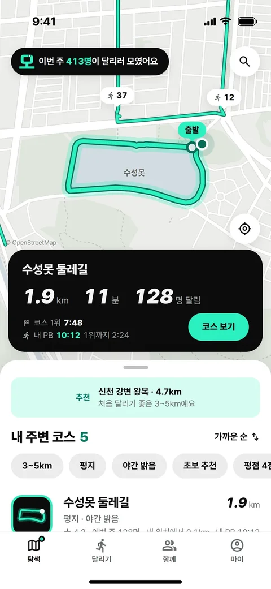<br /><sub><b>탐색</b></sub></td>
    <td align="center">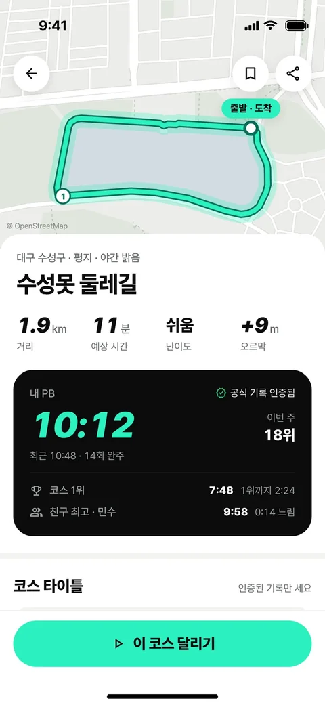<br /><sub><b>코스 상세</b></sub></td>
    <td align="center">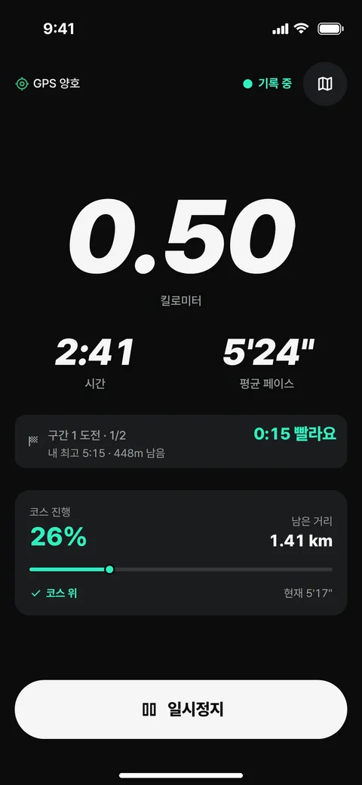<br /><sub><b>달리기</b></sub></td>
    <td align="center">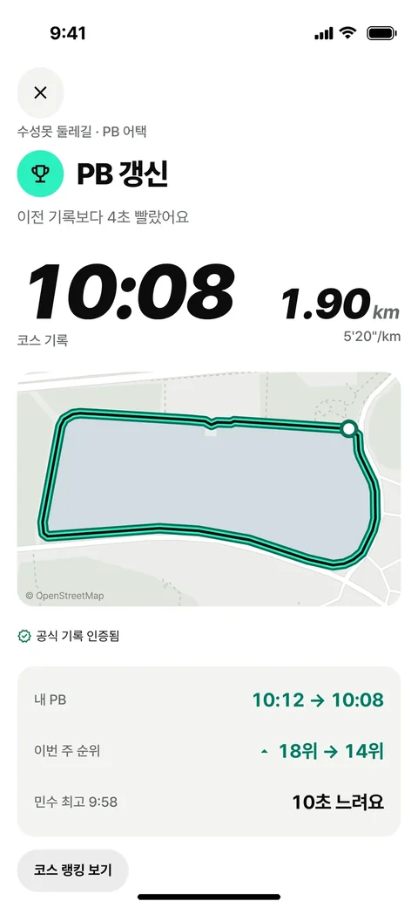<br /><sub><b>결과</b></sub></td>
    <td align="center">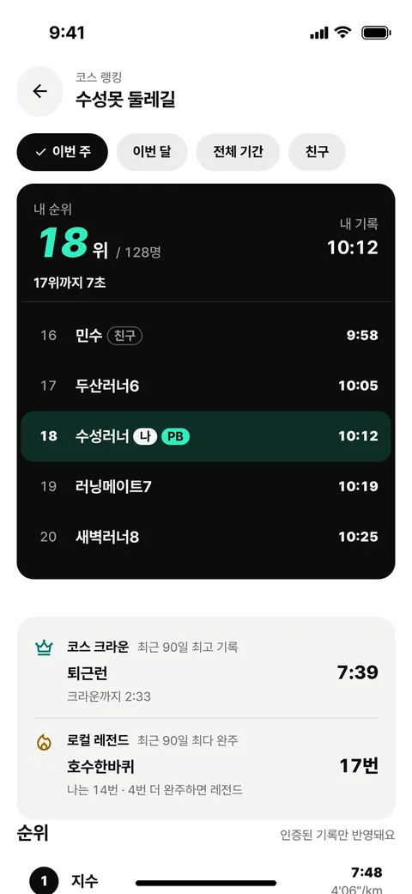<br /><sub><b>코스 랭킹</b></sub></td>
  </tr>
  <tr>
    <td align="center">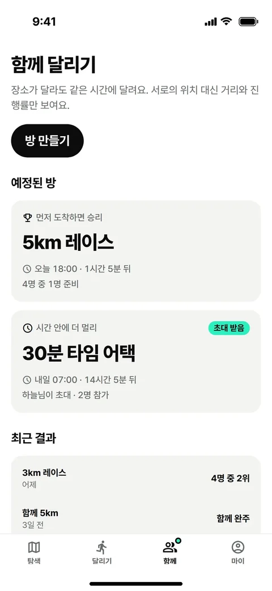<br /><sub><b>함께 달리기</b></sub></td>
    <td align="center">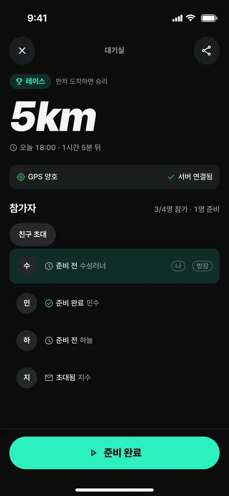<br /><sub><b>대기실</b></sub></td>
    <td align="center">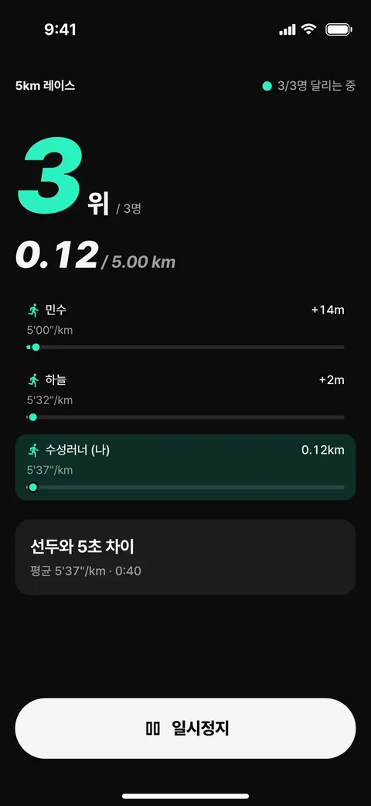<br /><sub><b>실시간 레이스</b></sub></td>
    <td align="center">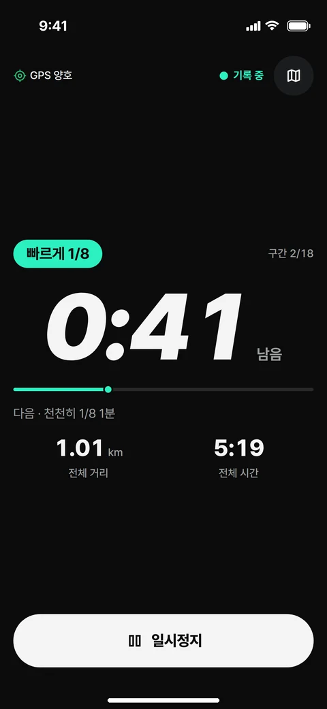<br /><sub><b>인터벌</b></sub></td>
    <td align="center">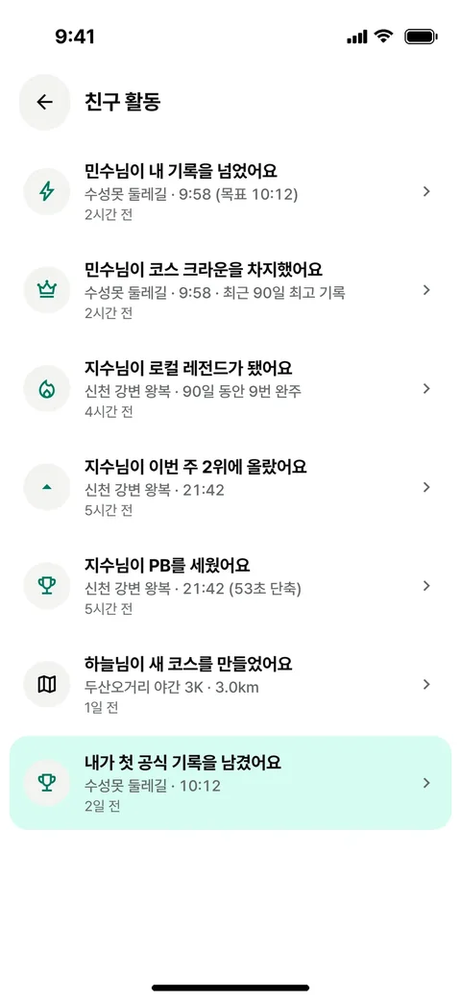<br /><sub><b>친구 활동</b></sub></td>
  </tr>
</table>

<br />

## 🔀 유저 플로우

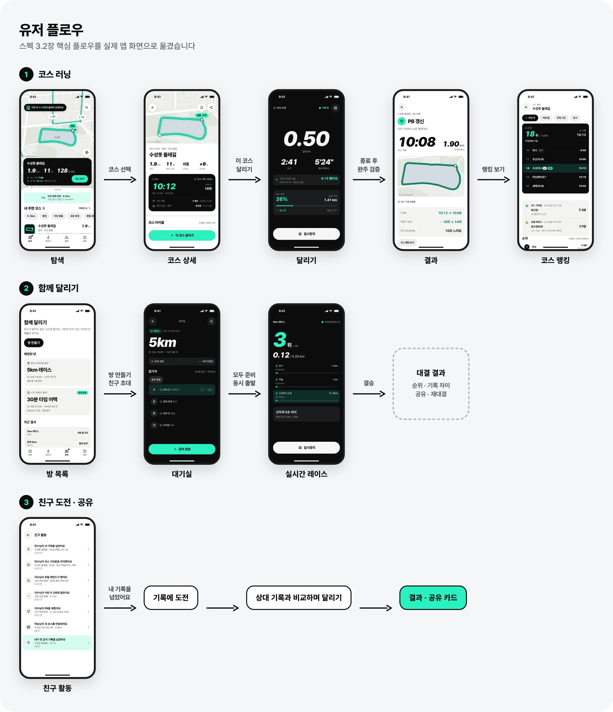

<br />

## ✨ 주요 기능

<table>
  <tr>
    <td width="200" align="center"></td>
    <td>
      <h3>🗺️ 코스 탐색 · 등록</h3>
      <ul>
        <li>지도에서 주변 코스와 출발점까지 거리를 봅니다</li>
        <li>이름 · 지역 · 특징으로 검색하고 거리 · 평점으로 거릅니다</li>
        <li>평소 달리는 거리에 맞춰 10km 안 코스 하나를 추천합니다</li>
        <li>달린 경로로 코스를 만들고, 내 코스는 고치거나 지울 수 있습니다</li>
        <li>두루누비 · OpenStreetMap 공공 코스도 서버가 가져옵니다</li>
      </ul>
    </td>
  </tr>
  <tr>
    <td width="200" align="center"></td>
    <td>
      <h3>⏱️ 달리기 · 공식 기록</h3>
      <ul>
        <li>화면을 꺼도 백그라운드에서 GPS로 기록합니다</li>
        <li>1km마다 구간 페이스를 보여 주고, 정한 거리마다 음성으로 안내합니다</li>
        <li>잠금 화면 · 다이내믹 아일랜드에 거리 · 시간 · 페이스가 보입니다</li>
        <li>코스를 끝까지 달리면 경로를 확인해 공식 기록으로 인증합니다</li>
        <li>인터벌 달리기를 지원합니다</li>
      </ul>
    </td>
  </tr>
  <tr>
    <td width="200" align="center"></td>
    <td>
      <h3>🏆 랭킹 · 경쟁</h3>
      <ul>
        <li>코스마다 이번 주 · 이번 달 · 전체 기간 · 친구 순위가 있습니다</li>
        <li>코스 크라운(90일 최고 기록)과 로컬 레전드(최다 완주)가 있습니다</li>
        <li>고스트 러너: 내 최고 기록이 지도 위에서 같이 달립니다</li>
        <li>구간 도전, 친구 기록 도전으로 다시 달릴 이유를 만듭니다</li>
      </ul>
    </td>
  </tr>
  <tr>
    <td width="200" align="center"></td>
    <td>
      <h3>🤝 함께 달리기</h3>
      <ul>
        <li>친구와 같은 시간에 출발해 레이스나 타임 어택을 합니다</li>
        <li>대기실에서 모두 준비되면 동시에 출발합니다</li>
        <li>위치는 보내지 않고 거리 · 페이스만 주고받습니다</li>
        <li>끝나면 순위와 기록 차이를 보여 주고 공유 · 재대결로 이어집니다</li>
      </ul>
    </td>
  </tr>
</table>

**그 밖에**

- ⌚ **Apple Watch:** 워치에서 기록을 보고 일시정지 · 종료합니다. 휴대폰 없이 워치만으로도 기록합니다.
- ❤️ **심박:** 워치나 블루투스 심박 벨트로 심박을 남깁니다.
- 🍎 **건강 앱 가져오기:** Apple 건강에 있는 다른 앱 운동 기록과 경로를 가져옵니다.
- 🔔 **친구 · 알림:** 친구가 내 기록을 넘거나 크라운을 차지하면 활동 피드와 푸시로 알려 줍니다.

<br />

## 🛠 기술 스택

| 분류 | 기술 |
| :---: | --- |
| **Mobile** |       |
| **Native · Watch** |      |
| **Backend** |       |
| **Database** |    |
| **Infra · DevOps** |      |
| **Test** |    |
| **Web** |     |

<br />

## 🏗 시스템 아키텍처

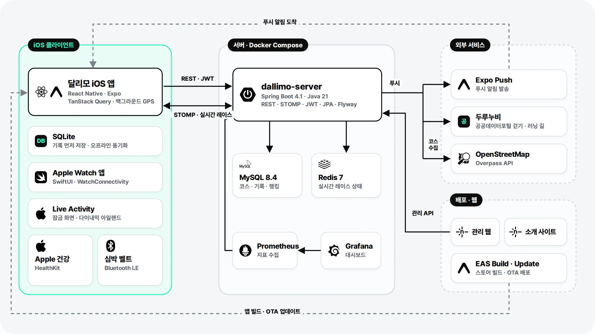

| 설계 포인트 | 방법 |
| --- | --- |
| 📴 오프라인 우선 기록 | GPS 점을 휴대폰 SQLite에 먼저 쌓고 묶음으로 올립니다. 연결이 끊겨도 기록은 계속됩니다 |
| ✅ 공식 기록 검증 | 서버가 GPS 점으로 거리를 다시 계산하고, 코스 경로를 따라 완주했는지 확인한 기록만 랭킹에 넣습니다 |
| ⚡ 실시간 레이스 | 참가자 진행 상태는 Redis에 두고 STOMP로 같은 방에만 보냅니다. 위치 좌표는 보내지 않습니다 |
| 🔗 공유 링크 | `/s/{code}` 링크를 서버가 웹 페이지로 보여 주고, 앱이 있으면 Universal Link로 앱을 엽니다 |
| 🚚 앱 업데이트 | JS 변경은 EAS Update로 심사 없이 내보내고, 서버가 알려 주는 최소 버전으로 강제 업데이트를 안내합니다 |

<br />

## 🚀 성능 개선

사용자 2만 명 · 코스 1만 개 · 공식 기록 30만 건 데이터를 넣고 같은 부하로 개선 전후를 쟀습니다. 원인 분석과 측정 방법은 [`docs/perf/README.md`](docs/perf/README.md)에 있습니다.

| 대상 | 개선 전 p95 | 개선 후 p95 | 처리량 |
| --- | ---: | ---: | ---: |
| 🏆 코스 랭킹 (전체 기간) | 1,540ms | **106ms** | **17.7배** |
| 🙋 내 순위 | 4,183ms | **336ms** | **21.0배** |
| 📍 코스 상세 | 1,477ms | **206ms** | **8.9배** |
| 🗺️ 주변 코스 (반경 10km) | 720ms | **279ms** | **2.8배** |
| 📡 GPS 업로드 (러너 20명 동시) | 묶음당 p50 286ms | **173ms** | **1.56배** |

<details>
<summary><b>무엇을 바꿨나</b></summary>
<br />

- **랭킹 · 내 순위:** 요청마다 기록 10만 건을 묶던 쿼리를 사용자별 최고 기록 projection 표로 바꿨습니다.
- **코스 상세:** "이번 주 달린 사람 수" 쿼리에 맞는 인덱스를 추가해 414ms를 3.3ms로 줄였습니다.
- **주변 코스:** 후보 약 4,800개를 모두 엔티티로 만들던 것을 id · 출발점만 읽고, 거리순으로 자른 20개만 불러오게 바꿨습니다.
- **GPS 업로드:** 묶음마다 점 전체를 다시 세던 연속 seq 확인을 저장한 값 뒤부터만 세게 바꿨습니다. 점 60개를 한 문장씩 보내던 INSERT는 묶어서 보냅니다.

</details>

<br />

## 📂 프로젝트 구조

```text
dallimo/
├─ frontend/   # iOS 앱 (Expo). targets/에 워치 앱 · Live Activity, modules/에 네이티브 모듈
├─ backend/    # Spring Boot 서버 (backend/dallimo-server). monitoring/에 Prometheus · Grafana
├─ admin/      # 관리 웹 (사용자 · 신고 · 모니터링 · 공지)
├─ landing/    # 소개 사이트 · 약관 · 문의 페이지
├─ promo/      # 홍보 영상 · App Store 스크린샷 (Remotion)
└─ docs/       # 스펙 · API 계약(openapi.yaml) · 성능 측정 · 스토어 등록 자료
```

<br />

## ⚙️ 시작하기

<details>
<summary><b>📱 앱</b> · Node.js 20 이상</summary>
<br />

```bash
cd frontend
npm install
npm start            # expo start. 기본으로 배포 서버에 붙습니다 (.env.development)
npm run typecheck
npm run lint
```

- 다른 서버로 띄우려면 `frontend/.env.local`의 `EXPO_PUBLIC_API_URL`을 바꿉니다. 비워 두면 서버 없이 mock 데이터로 동작합니다(`.env.example` 참고).
- 패키지는 `npx expo install <package>`로 추가합니다.

</details>

<details>
<summary><b>🖥️ 서버</b> · JDK 21 · MySQL · Redis</summary>
<br />

```bash
cd backend/dallimo-server
DB_USERNAME=... DB_PASSWORD=... ./gradlew bootRun   # dev 프로필. Flyway가 테이블을 만듭니다
./gradlew test                                       # Docker 필요 (Testcontainers)
```

자세한 설정은 [`backend/README.md`](backend/README.md)에 있습니다.

</details>

<details>
<summary><b>🌐 소개 사이트 · 관리 웹 · 홍보 영상</b></summary>
<br />

```bash
cd landing && npm install && npm run dev      # landing/README.md
cd admin && npm install && npm run dev        # admin/README.md
cd promo && npm install && npm run studio     # promo/README.md
```

</details>

<details>
<summary><b>🔖 앱 식별자</b></summary>
<br />

| 항목 | 값 |
| --- | --- |
| 홈 화면 이름 | 달리모 |
| iOS 번들 ID | `com.dongseopseo.dallimo` |
| 워치 앱 번들 ID | `com.dongseopseo.dallimo.watchkitapp` |
| URL scheme | `dallimo` |
| 공유 링크 | `https://dallimo.gamjabox.cloud/s/{code}` (Universal Link) |

</details>

<details>
<summary><b>📄 문서 · 작업 규칙</b></summary>
<br />

| 문서 | 내용 |
| --- | --- |
| `docs/spec/` | 마스터 스펙 v1.8 (원본 docx와 Markdown 추출본) |
| `docs/api/openapi.yaml` | REST API 계약. 서버 테스트가 코드와 같은지 확인합니다 |
| `docs/perf/README.md` | 서버 성능 측정 · 개선 결과 |
| `docs/store/APP-STORE.md` | App Store 등록 자료 |
| `frontend/docs/ui/FOUNDATION-DECISION-LOG.md` | 설계 결정 기록 |
| `frontend/docs/deploy/APP-RELEASE-SETUP.md` | 앱 빌드 · 출시 설정 |
| `frontend/CLAUDE.md`, `frontend/docs/ui/` | 앱 UI/UX 구현 규칙 |

- 브랜치는 `main`에서 기능별로 만들고 `feat/` · `fix/` · `refactor/` · `design/` · `docs/`로 시작합니다.
- PR 제목과 본문은 한국어로 씁니다.
- 비밀 값(DB · JWT · 인증 키)은 저장소에 넣지 않습니다.

</details>

<br />

<div align="center">
  
  <br />
  <sub>© 2026 Dallimo</sub>
</div>
