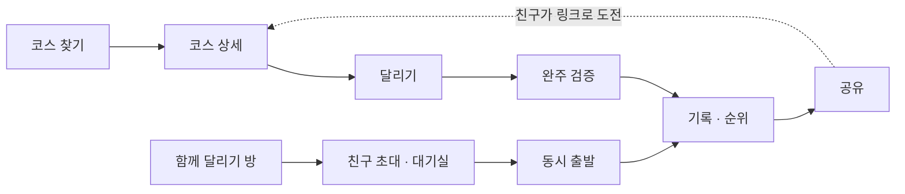
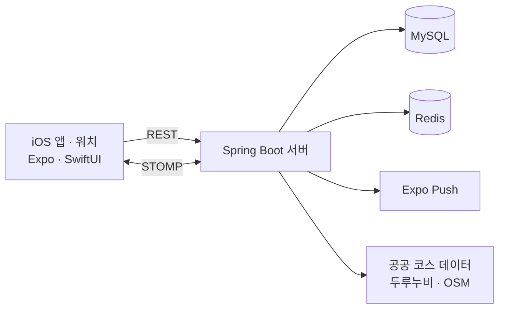

<div align="center">


# 달리모

**코스를 찾고, 같이 달리고, 기록을 깨다.**

주변 러닝 코스에서 기록으로 순위를 겨루고, 멀리 사는 친구와 같은 시간에 함께 달리는 iOS 앱

<a href="https://apps.apple.com/kr/app/%EB%8B%AC%EB%A6%AC%EB%AA%A8/id6818753247"></a>

[소개 사이트](https://dallimo-landing.kro.kr/) · [API 문서](https://dallimo.gamjabox.cloud/swagger-ui.html)

<br />


</div>

<br />

## 왜 만들었나

| 러너의 불편 | 달리모의 해결 |
| --- | --- |
| 오늘 어디서 뛸지 매번 찾아야 한다 | 주변 코스를 지도에 바로 보여 주고 평소 거리에 맞는 코스를 추천 |
| 같은 길을 혼자 뛰면 지루하다 | 코스마다 랭킹 · 내 최고 기록 · 크라운으로 다시 뛸 이유를 만듦 |
| 친구와 사는 곳 · 일정이 다르다 | 같은 시간에 출발해 각자 동네에서 실시간 레이스 |

## 누구를 위한 앱인가

주 1~3회 달리는 취미 러너가 주 타깃입니다 (스펙 1.4장). 아래는 이를 바탕으로 만든 가상 인물입니다.

| 페르소나 | 상황 | 달리모에서 하는 일 |
| --- | --- | --- |
| **지수** (29, 회사원) | 퇴근 후 늘 같은 강변을 달려 지루하다 | 코스를 바꿔 가며 달리고 이번 주 순위를 확인 |
| **민수** (34, 출장 잦음) | 낯선 도시에서 뛸 곳을 찾느라 시간을 쓴다 | 지역을 검색하고 완주 수 · 평점을 보고 코스 선택 |
| **하늘** (26, 대학원생) | 같이 뛰던 친구들이 여러 도시로 흩어졌다 | 레이스 방을 만들어 친구들과 동시에 출발 |

## 유저 플로우



## 주요 기능

| 기능 | 설명 |
| --- | --- |
| 코스 탐색 · 등록 | 주변 코스 검색과 추천. 달린 경로로 코스를 만들고 고치거나 지울 수 있음 |
| 달리기 기록 | 백그라운드 GPS, km 구간 페이스, 음성 안내, 인터벌, 잠금 화면 표시 |
| 공식 기록 · 랭킹 | 완주를 경로로 확인한 기록만 순위에 반영. 주간 · 월간 · 친구 랭킹 |
| 경쟁 | 고스트 러너(내 최고 기록과 달리기), 구간 도전, 친구 기록 도전 |
| 함께 달리기 | 레이스 · 타임 어택. 위치 대신 거리와 페이스만 주고받음 |
| Apple Watch · 건강 | 워치로 기록 확인과 조작. 심박 벨트 연결. 다른 앱 운동 기록 가져오기 |

## 시스템 아키텍처



- **오프라인 우선:** 기록은 휴대폰 SQLite에 먼저 저장하고, 연결되면 서버로 올립니다.
- **실시간 레이스:** 참가자 상태는 Redis에 두고 STOMP로 같은 방에만 보냅니다.
- **배포:** 서버는 Docker Compose, 앱은 EAS Build · Update, 웹은 Netlify에 올립니다.

## 기술 스택

| 영역 | 기술 |
| --- | --- |
| 앱 | React Native 0.86 · Expo SDK 57 · TypeScript · TanStack Query · SQLite |
| 워치 · 네이티브 | SwiftUI · HealthKit · WatchConnectivity · Live Activity · CoreBluetooth |
| 서버 | Java 21 · Spring Boot 4.1 · JPA · WebSocket(STOMP) · Flyway |
| 데이터 · 운영 | MySQL 8.4 · Redis 7 · Prometheus · Grafana · Testcontainers |
| 웹 | React · Vite (소개 사이트 · 관리 웹) |

## 서버 성능 개선

같은 데이터(사용자 2만 · 코스 1만 · 기록 30만 건)로 개선 전후 p95를 쟀습니다. 자세한 내용은 [`docs/perf/README.md`](docs/perf/README.md)에 있습니다.

| 대상 | 개선 전 | 개선 후 |
| --- | ---: | ---: |
| 코스 랭킹 | 1,540ms | **106ms** |
| 내 순위 | 4,183ms | **336ms** |
| 코스 상세 | 1,477ms | **206ms** |
| 주변 코스 | 720ms | **279ms** |

## 개발

<details>
<summary><b>저장소 구조</b></summary>

```text
dallimo/
├─ frontend/   # iOS 앱 · 워치 앱 (Expo)
├─ backend/    # Spring Boot 서버
├─ admin/      # 관리 웹
├─ landing/    # 소개 사이트
├─ promo/      # 홍보 영상 · 스토어 이미지 (Remotion)
└─ docs/       # 스펙 · API 계약 · 성능 측정 · 스토어 자료
```

</details>

<details>
<summary><b>실행 방법</b></summary>

```bash
# 앱 (Node.js 20+)
cd frontend && npm install && npm start

# 서버 (JDK 21, MySQL, Redis)
cd backend/dallimo-server
DB_USERNAME=... DB_PASSWORD=... ./gradlew bootRun
./gradlew test   # Docker 필요

# 웹
cd landing && npm install && npm run dev
cd admin && npm install && npm run dev
```

- 앱이 붙을 서버는 `frontend/.env.local`의 `EXPO_PUBLIC_API_URL`로 바꿉니다. 비워 두면 mock 데이터로 동작합니다.
- 서버 설정은 [`backend/README.md`](backend/README.md)에 있습니다.

</details>

<details>
<summary><b>앱 식별자</b></summary>

| 항목 | 값 |
| --- | --- |
| iOS 번들 ID | `com.dongseopseo.dallimo` |
| 워치 앱 번들 ID | `com.dongseopseo.dallimo.watchkitapp` |
| URL scheme | `dallimo` |
| 공유 링크 | `https://dallimo.gamjabox.cloud/s/{code}` |

</details>

<details>
<summary><b>문서 · 작업 규칙</b></summary>

| 문서 | 내용 |
| --- | --- |
| `docs/spec/` | 마스터 스펙 v1.8 |
| `docs/api/openapi.yaml` | REST API 계약 |
| `docs/perf/README.md` | 성능 측정 결과 |
| `docs/store/APP-STORE.md` | App Store 등록 자료 |
| `frontend/docs/ui/FOUNDATION-DECISION-LOG.md` | 설계 결정 기록 |

- 브랜치는 `main`에서 만들고 `feat/` · `fix/` · `refactor/` · `design/` · `docs/`로 시작합니다.
- PR은 한국어로 씁니다. 비밀 값은 저장소에 넣지 않습니다.

</details>
