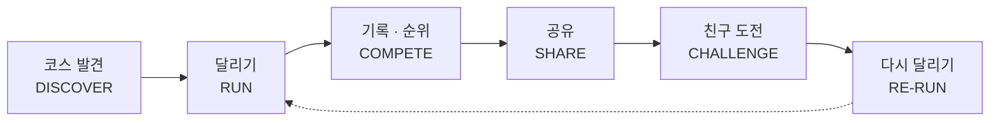
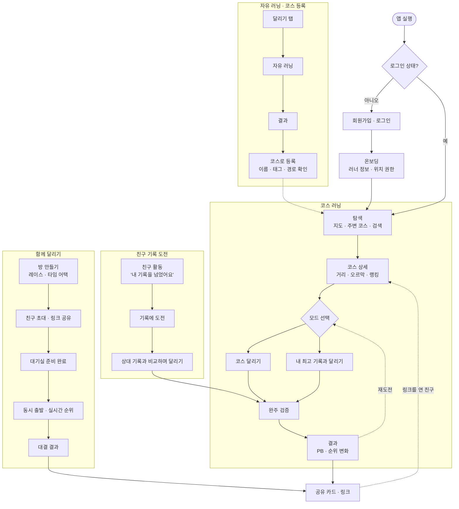
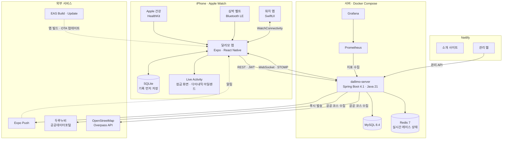
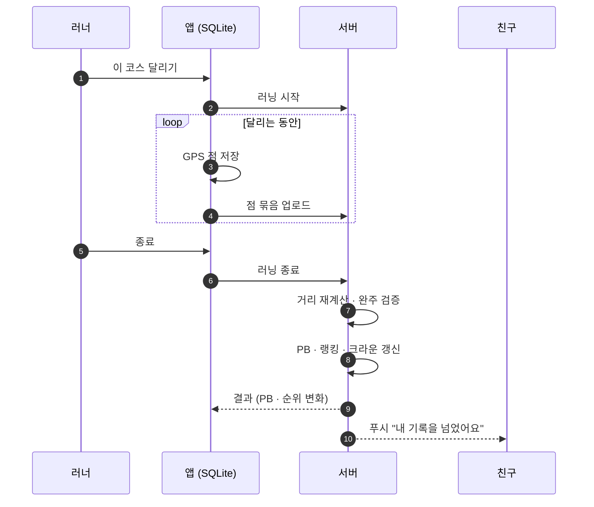

<div align="center">


# 달리모 · DALLIMO

**코스를 찾고, 같이 달리고, 기록을 깨다.**

주변 러닝 코스를 찾고, 코스마다 공식 기록으로 순위를 겨루고,<br />
사는 곳이 달라도 친구와 같은 시간에 함께 달리는 iOS 러닝 앱입니다.

<a href="https://apps.apple.com/kr/app/%EB%8B%AC%EB%A6%AC%EB%AA%A8/id6818753247"></a>

[소개 사이트](https://dallimo-landing.kro.kr/) · [API 문서 (Swagger)](https://dallimo.gamjabox.cloud/swagger-ui.html) · [마스터 스펙](docs/spec/dallimo_master_spec_v1.8.md)


<br />


&nbsp;

&nbsp;


</div>

<br />

## 목차

1. [서비스 기획](#서비스-기획)
2. [화면](#화면)
3. [유저 플로우](#유저-플로우)
4. [주요 기능](#주요-기능)
5. [시스템 아키텍처](#시스템-아키텍처)
6. [기술 스택](#기술-스택)
7. [서버 성능 개선](#서버-성능-개선)
8. [저장소 구조](#저장소-구조)
9. [실행](#실행)
10. [앱 식별자 · 문서 · 작업 규칙](#앱-식별자)

<br />

## 서비스 기획

### 한 줄 정의

달리모는 **코스가 중심인 러닝 앱**입니다. 다른 러너가 공유한 코스를 찾고, 같은 코스에서 내 기록 · 친구 · 다른 러너와 겨룹니다. 피드를 넘기는 SNS도, 훈련 계획을 짜 주는 코치 앱도 아닙니다. 모든 기록과 대결은 코스 하나로 이어집니다.

### 풀려는 문제

| 러너가 겪는 불편 | 달리모가 하는 일 |
| --- | --- |
| 오늘 어디서 뛸지 매번 지도를 뒤진다 | 주변 코스를 지도에 바로 띄우고 출발점까지 거리를 보여 줍니다. 평소 거리에 맞는 코스 하나를 추천합니다 |
| 같은 길을 혼자 뛰면 금방 지루해진다 | 코스마다 랭킹 · 내 최고 기록 · 크라운이 있어 다시 뛸 이유가 생깁니다 |
| 친구와 뛰고 싶어도 사는 곳과 일정이 다르다 | 같은 시간에 출발해 각자 동네에서 레이스를 합니다. 위치 대신 거리와 페이스만 주고받습니다 |
| 기록을 올려도 반응이 거기서 끝난다 | 공유 카드 링크를 연 친구가 같은 코스로 도전하게 이어 줍니다 |

### 핵심 가치

| 축 | 사용자가 얻는 것 | 핵심 기능 |
| --- | --- | --- |
| 🗺️ **COURSE** | 오늘 어디서 뛸지 빨리 정한다 | 주변 코스, 지역 검색, 코스 상세, 코스 등록 |
| 🏆 **COMPETE** | 달릴 이유와 재도전 동기가 생긴다 | PB, 코스 랭킹, 친구 기록 도전 |
| 🤝 **TOGETHER** | 장소가 달라도 같이 달린다 | 예약 러닝, 동시 출발, 실시간 진행률 · 순위 |
| 🔗 **SHARE** | 러닝 결과가 다음 러닝으로 이어진다 | 기록 · 코스 · 대결 카드, 딥 링크, 재도전 |

### 핵심 순환

한 번 달리고 끝나지 않게, 결과가 다음 러닝의 출발점이 되도록 설계했습니다.



### 주 타깃

스펙 1.4장의 주요 사용자입니다.

- 주 1~3회 달리는 취미 러너
- 같은 코스 반복이 지루하거나, 처음 가 본 동네에서 코스를 찾고 싶은 러너
- 친구와 달리고 싶지만 장소 · 일정이 다른 러너
- 러닝 결과를 SNS · 메신저로 공유하고 기록 경쟁을 즐기는 러너

### 페르소나

위 주 타깃을 바탕으로 만든 가상 인물입니다. 실제 사용자 인터뷰 결과는 아닙니다.

| | 지수 (29) | 민수 (34) | 하늘 (26) |
| --- | --- | --- | --- |
| 상황 | 회사원. 퇴근 후 집 앞 강변을 달린다 | 출장이 잦아 낯선 도시에서 자주 묵는다 | 대학 러닝 동아리 친구들이 졸업 후 여러 도시로 흩어졌다 |
| 러닝 습관 | 주 2~3회, 5km 안팎 | 주 1~2회, 숙소 근처에서 | 주 2회, 예전엔 동아리와 같이 |
| 불편한 점 | 매번 같은 길이라 지루하다. 기록이 늘었는지 잘 모른다 | 어디가 뛰기 좋은 길인지 검색하다 시간이 간다 | 혼자 뛰면 금방 그만둔다. 친구들과 시간 맞추기가 어렵다 |
| 달리모에서 하는 일 | 주변 코스를 바꿔 가며 달린다. 코스별 PB와 이번 주 순위를 확인한다 | 출장지에서 지역을 검색하고, 완주한 사람 수와 평점을 보고 코스를 고른다 | 저녁 9시에 5km 레이스 방을 만들고 친구를 초대한다. 각자 동네에서 동시에 출발한다 |
| 주로 쓰는 기능 | 코스 랭킹, 고스트 러너, 크라운 | 지역 검색, 코스 상세, 오프라인 기록 | 함께 달리기, 친구 기록 도전, 공유 카드 |

### 제품 원칙

| 원칙 | 구현 |
| --- | --- |
| 기록 정확성 우선 | GPS 정확도 · 순간 이동 · 비정상 속도를 걸러 냅니다. 코스를 끝까지 달렸는지 경로로 확인합니다 |
| 코스 중심 | 랭킹 · 도전 · 공유가 모두 코스에 붙어 있습니다 |
| 개인 기록은 네트워크와 분리 | 기록은 휴대폰 SQLite에 먼저 저장합니다. 연결이 끊겨도 기록은 남고, 다시 연결되면 올립니다 |
| 공식 랭킹은 검증된 기록만 | 완주 검증을 통과한 기록만 순위에 들어갑니다 |
| 소셜은 다음 러닝으로 | 친구 활동 알림은 "기록에 도전하기" 같은 다음 행동으로 이어집니다 |

<br />

## 화면

<table>
  <tr>
    <td align="center"><br /><sub><b>탐색</b><br />주변 코스 · 추천</sub></td>
    <td align="center"><br /><sub><b>코스 상세</b><br />거리 · 오르막 · 내 PB</sub></td>
    <td align="center"><br /><sub><b>코스 랭킹</b><br />주간 · 크라운 · 레전드</sub></td>
    <td align="center"><br /><sub><b>달리기</b><br />구간 도전 · 코스 진행</sub></td>
    <td align="center"><br /><sub><b>결과</b><br />PB 갱신 · 순위 변화</sub></td>
  </tr>
  <tr>
    <td align="center"><br /><sub><b>함께 달리기</b><br />예정된 방</sub></td>
    <td align="center"><br /><sub><b>대기실</b><br />참가자 준비 상태</sub></td>
    <td align="center"><br /><sub><b>실시간 레이스</b><br />순위 · 선두와 차이</sub></td>
    <td align="center"><br /><sub><b>인터벌</b><br />남은 시간 · 다음 구간</sub></td>
    <td align="center"><br /><sub><b>친구 활동</b><br />기록 추월 · 크라운</sub></td>
  </tr>
</table>

<br />

## 유저 플로우

스펙 3.2장의 핵심 플로우를 실제 앱 화면 기준으로 그렸습니다.



<br />

## 주요 기능

| 기능 | 내용 |
| --- | --- |
| 코스 탐색 | 지도에서 주변 코스와 출발점까지 거리를 봅니다. 이름 · 지역 · 특징으로 검색하고 거리 · 평점으로 거릅니다. 평소 달리는 거리에 맞춰 10km 안 코스 하나를 추천합니다 |
| 코스 등록 · 관리 | 달린 기록으로 코스를 만듭니다. 내가 만든 코스는 이름 · 설명 · 태그를 고치거나 지울 수 있습니다. 두루누비 · OpenStreetMap 공공 코스도 서버가 가져옵니다 |
| 달리기 기록 | 거리 · 시간 · 페이스를 크게 보여 줍니다. 1km마다 구간 페이스를 보여 주고, 아래로 넘기면 구간 목록이 나옵니다. 화면을 꺼도 백그라운드에서 기록하고 정한 거리마다 음성으로 안내합니다. 인터벌 달리기를 지원합니다 |
| 공식 기록 | 코스를 끝까지 달리면 경로를 확인해 공식 기록으로 인증합니다. 내 최고 기록(PB)과 순위 변화를 바로 보여 줍니다 |
| 랭킹 | 코스마다 이번 주 · 이번 달 · 전체 기간 · 친구 순위가 있습니다. 코스 크라운(90일 최고 기록)과 로컬 레전드(최다 완주)가 있습니다 |
| 고스트 러너 · 구간 도전 | 내 최고 기록이 지도 위에서 같이 달립니다. 코스 안 구간 기록에 도전합니다 |
| 함께 달리기 | 친구와 같은 시간에 출발해 레이스나 타임 어택을 합니다. 위치는 보내지 않고 거리 · 페이스만 주고받습니다 |
| 친구 · 알림 | 친구가 내 기록을 넘거나 크라운을 차지하면 활동 피드와 푸시로 알려 줍니다 |
| 잠금 화면 | 달리는 동안 잠금 화면과 다이내믹 아일랜드에 거리 · 시간 · 페이스가 보입니다 (Live Activity) |
| Apple Watch · 건강 | 워치에서 거리 · 시간 · 페이스를 보고 일시정지 · 종료합니다. 워치나 블루투스 심박 벨트로 심박을 남깁니다. Apple 건강의 다른 앱 운동 기록과 경로를 가져옵니다 |

<br />

## 시스템 아키텍처



### 설계 포인트

| 주제 | 방법 |
| --- | --- |
| 오프라인에서도 기록 유지 | GPS 점은 휴대폰 SQLite에 먼저 쌓고 묶음으로 서버에 올립니다. 연결이 끊기면 기다렸다가 이어서 올립니다 |
| 공식 기록 검증 | 달리기가 끝나면 서버가 GPS 점을 다시 계산합니다. 정확도 · 순간 이동 · 속도 규칙을 통과하고 코스 경로를 따라 완주해야 공식 기록이 됩니다 |
| 실시간 레이스 | 참가자 진행 상태는 Redis에 두고 STOMP로 방 안에만 보냅니다. 위치 좌표는 보내지 않습니다 |
| 랭킹 조회 속도 | 요청마다 기록을 묶지 않고, 사용자별 최고 기록 표를 따로 두고 갱신합니다 |
| 공유 링크 | `/s/{code}` 링크를 서버가 웹 페이지로 보여 주고, 앱이 있으면 Universal Link로 앱을 엽니다 |
| 앱 업데이트 | JS 변경은 EAS Update로 스토어 심사 없이 내보냅니다. 서버가 최소 버전을 알려 주면 앱이 업데이트를 안내합니다 |

### 기록이 공식 기록이 되기까지



<br />

## 기술 스택

| 영역 | 기술 |
| --- | --- |
| 앱 | React Native 0.86 · Expo SDK 57 · Expo Router · TypeScript · TanStack Query · react-native-maps · expo-location / task-manager(백그라운드 GPS) · expo-sqlite(오프라인 저장) · STOMP · expo-updates(OTA) |
| 네이티브 모듈 | HealthKit · WatchConnectivity · Live Activity · CoreBluetooth(심박 벨트). `frontend/modules/`에 있습니다 |
| 워치 | SwiftUI watchOS 앱(`@bacons/apple-targets`) · WatchConnectivity · HealthKit |
| 서버 | Java 21 · Spring Boot 4.1 (Web MVC · Data JPA · JDBC · WebSocket(STOMP) · Flyway · Actuator) · springdoc OpenAPI |
| 데이터 | MySQL 8.4 · Redis 7(실시간 레이스 상태) |
| 모니터링 | Prometheus · Grafana |
| 테스트 | JUnit 5 · Testcontainers(MySQL 8.4 · MariaDB 11.4 · Redis) · OpenAPI 계약 테스트 |
| 소개 사이트 | React · Vite · Tailwind CSS · motion. 빌드 때 HTML로 미리 그려 Netlify에 올립니다 |
| 관리 웹 | React · Vite. Netlify에 올립니다 |
| 홍보 영상 · 스토어 이미지 | Remotion |
| 배포 | 서버: Docker Compose · 앱: EAS Build / Update · 웹: Netlify |

<br />

## 서버 성능 개선

같은 데이터(사용자 2만 명 · 코스 1만 개 · 공식 기록 30만 건)와 같은 부하로 개선 전후를 쟀습니다. 자세한 원인 분석과 방법은 [`docs/perf/README.md`](docs/perf/README.md)에 있습니다.

| 대상 | 개선 전 p95 | 개선 후 p95 | 처리량 |
| --- | ---: | ---: | ---: |
| 코스 랭킹 (전체 기간) | 1,540ms | **106ms** | 17.7배 |
| 내 순위 | 4,183ms | **336ms** | 21.0배 |
| 코스 상세 | 1,477ms | **206ms** | 8.9배 |
| 주변 코스 (반경 10km) | 720ms | **279ms** | 2.8배 |
| GPS 업로드 (러너 20명 동시) | 묶음당 p50 286ms | **173ms** | 1.56배 |

- 랭킹 · 내 순위: 요청마다 기록 10만 건을 묶던 쿼리를 사용자별 최고 기록 projection 표로 바꿨습니다.
- 코스 상세: "이번 주 달린 사람 수" 쿼리에 맞는 인덱스를 추가해 414ms를 3.3ms로 줄였습니다.
- 주변 코스: 후보 약 4,800개를 모두 엔티티로 만들던 것을 id · 출발점만 읽고, 거리순으로 자른 20개만 불러오게 바꿨습니다.
- GPS 업로드: 묶음마다 러닝의 점 전체를 다시 세던 연속 seq 확인을 저장한 값 뒤부터만 세게 바꿨습니다. 점 60개를 한 문장씩 보내던 INSERT는 묶어서 보냅니다.

<br />

## 저장소 구조

```text
dallimo/
├─ frontend/   # iOS 앱 (Expo). targets/에 워치 앱 · Live Activity, modules/에 네이티브 모듈
├─ backend/    # Spring Boot 서버 (backend/dallimo-server). monitoring/에 Prometheus · Grafana
├─ admin/      # 관리 웹 (사용자 · 신고 · 모니터링 · 공지)
├─ landing/    # 소개 사이트 · 약관 · 문의 페이지
├─ promo/      # 홍보 영상 · App Store 스크린샷 (Remotion)
├─ docs/       # 명세, API 계약(openapi.yaml), 성능 측정, 스토어 등록 자료
├─ CLAUDE.md   # 저장소 공통 작업 규칙
└─ netlify.toml
```

<br />

## 실행

### 앱

Node.js 20 이상이 필요합니다.

```bash
cd frontend
npm install
npm start            # expo start. 기본으로 배포 서버에 붙습니다 (.env.development)
npm run typecheck
npm run lint
```

- 다른 서버로 띄우려면 `frontend/.env.local`의 `EXPO_PUBLIC_API_URL`을 바꿉니다. 비워 두면 서버 없이 mock 데이터로 동작합니다(`.env.example` 참고).
- 패키지는 `npx expo install <package>`로 추가합니다. SDK와 맞는 버전이 설치됩니다.

### 서버

JDK 21과 MySQL · Redis가 필요합니다. 자세한 설정은 [`backend/README.md`](backend/README.md)에 있습니다.

```bash
cd backend/dallimo-server
DB_USERNAME=... DB_PASSWORD=... ./gradlew bootRun   # dev 프로필. Flyway가 테이블을 만듭니다
./gradlew test                                       # Docker 필요 (Testcontainers)
```

### 소개 사이트 · 관리 웹 · 홍보 영상

```bash
cd landing && npm install && npm run dev      # 자세한 내용은 landing/README.md
cd admin && npm install && npm run dev        # 자세한 내용은 admin/README.md
cd promo && npm install && npm run studio     # 자세한 내용은 promo/README.md
```

<br />

## 앱 식별자

| 항목 | 값 |
| --- | --- |
| 홈 화면 이름 | 달리모 |
| iOS 번들 ID | `com.dongseopseo.dallimo` |
| 워치 앱 번들 ID | `com.dongseopseo.dallimo.watchkitapp` |
| URL scheme | `dallimo` |
| 공유 링크 | `https://dallimo.gamjabox.cloud/s/{code}` (Universal Link) |

## 문서

| 문서 | 내용 |
| --- | --- |
| `docs/spec/` | 마스터 스펙 v1.8 (원본 docx와 Markdown 추출본) |
| `docs/api/openapi.yaml` | REST API 계약. 서버 테스트가 코드와 같은지 확인합니다 |
| `docs/perf/README.md` | 서버 성능 측정 · 개선 결과 |
| `docs/store/APP-STORE.md` | App Store 등록 자료 (설명 · 키워드 · 스크린샷 · 심사 메모 · 앱 개인정보) |
| `frontend/docs/ui/FOUNDATION-DECISION-LOG.md` | 설계 결정 기록 |
| `frontend/docs/deploy/APP-RELEASE-SETUP.md` | 앱 빌드 · 출시 설정 |
| `frontend/CLAUDE.md`, `frontend/docs/ui/` | 앱 UI/UX 구현 규칙 |

## 작업 규칙

- 브랜치는 `main`에서 기능별로 만들고 `feat/` · `fix/` · `refactor/` · `design/` · `docs/`로 시작합니다.
- PR 제목과 본문은 한국어로 씁니다.
- 비밀 값(DB · JWT · 인증 키)은 저장소에 넣지 않습니다.

<br />

<div align="center"><sub>© 2026 Dallimo</sub></div>
